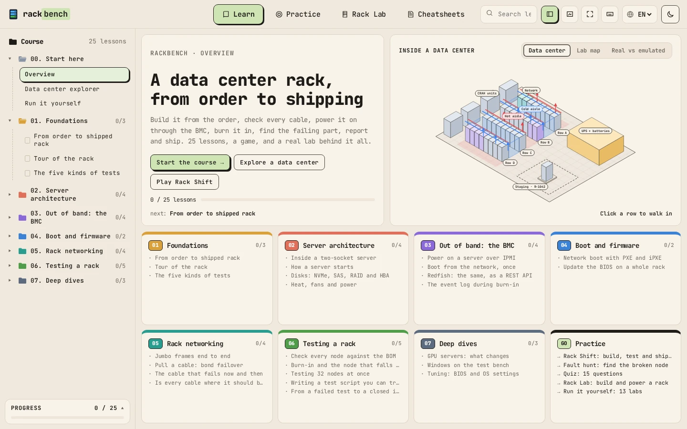
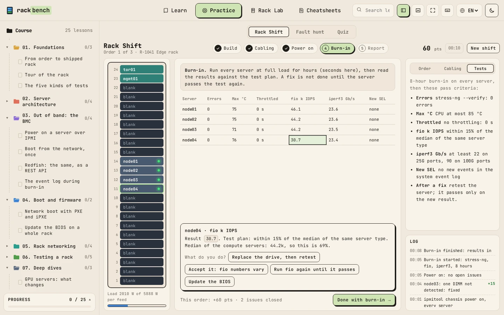

# rackbench-lab

The hands-on lab behind [Rackbench](https://rackbench.vercel.app) ([source](https://github.com/adam-bouafia/rackbench)): a small data center rack that runs on one Linux machine, for practising how racks are built, tested and repaired.

Three Ubuntu nodes on KVM and libvirt that report like two-socket servers (serial numbers, a BIOS version, two NUMA nodes); emulated BMCs that answer IPMI and Redfish; OpenBMC in QEMU as real BMC firmware; an iPXE server that boots machines from the network; a firmware tool that plays a vendor update tool; and a fault injector that plays the bad disk, the bad cable and the dead BMC.

Rackbench explains every part step by step; this repository is where you do it.

| | |
|---|---|
|  |  |
| Rackbench: the overview, 50 lessons in ten chapters | Rack Shift, the Rackbench game: build, cable, test and ship three racks |

The workflow is the real one; the numbers are not. Not affiliated with any hardware vendor.

## Requirements

- Linux with KVM and libvirt (written and tested on Fedora), your user in the `libvirt` group
- About 7.5 GB of free memory for three nodes and the desktop
- `virt-install`, `qemu-img`, `xorriso`, `jq`, `ipmitool`; `qemu-system-arm` for OpenBMC; Python 3 for the BMC emulators (installed in a venv)

## Quick start

```bash
cd lab
./provision-rack.sh                 # networks rack-data and rack-backend, nodes rk-n1..rk-n3
./snapshot-rack.sh save clean       # once all three report ready; revert clean undoes anything
./bmc.sh setup && ./bmc.sh start    # IPMI on 127.0.0.1:6231-6233, Redfish on 127.0.0.1:8000
source env.sh                       # shortcuts: bmc, rf, rfsys, rfpower, rfboot, onall, obmc, orf
bmc rk-n1 power status
./fw.sh list
./faults.sh random                  # find it, then ./faults.sh reveal and ./faults.sh clear
```

`provision-rack.sh` waits for cloud-init to install the test tools and reports a node as ready only when fio, stress-ng, iperf3 and memtester are really there; otherwise it points at the cloud-init log.

| Script | What it does |
|---|---|
| `provision-rack.sh` | builds the two networks and the three nodes (cloud-init installs the test tools) |
| `snapshot-rack.sh` | saves, reverts, lists and deletes snapshots of all three nodes at once |
| `teardown-rack.sh` | removes the nodes, their disks and the rack networks |
| `bmc.sh` | virtualbmc (IPMI) and sushy-tools (Redfish) for the nodes |
| `obmc.sh` | OpenBMC (Romulus image) in QEMU: real SEL, FRU, sensors and Redfish sessions |
| `fw.sh` | lists and "flashes" node BIOS versions, then cold-boots the node |
| `pxe.sh` | Alpine netboot files (resumable download), an HTTP boot server and a diskless test VM |
| `faults.sh` | injects, reveals and clears faults, alone or at random |
| `env.sh` | shell shortcuts for the commands above |
| `bom.yaml` | the golden configuration and asset list the nodes are checked against |

Faults: `data-disk-missing`, `slow-data-disk`, `backend-link-down`, `slow-backend`, `memory-missing`, `mgmt-link-down`, `bmc-down`, `cpu-throttle`, `flaky-link`, `bios-drift`, and `mtu-mismatch` once the bond exists.

Safety: stress tests and fio run inside the nodes only, and fio writes only to the data disk `/dev/vdb`.

## Keeping Rackbench in step

The fault hunt and Rack Shift on Rackbench mirror `lab/faults.sh`, and its lessons quote these scripts. When a fault or a script changes here, update the simulator and the lessons in [rackbench](https://github.com/adam-bouafia/rackbench).

## License

MIT, see `LICENSE`.
